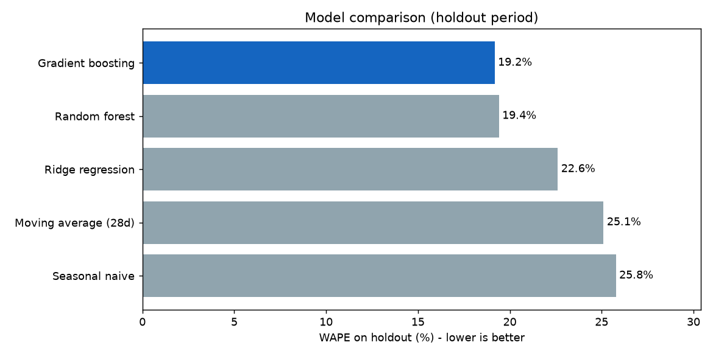
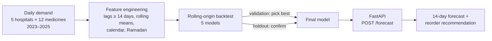
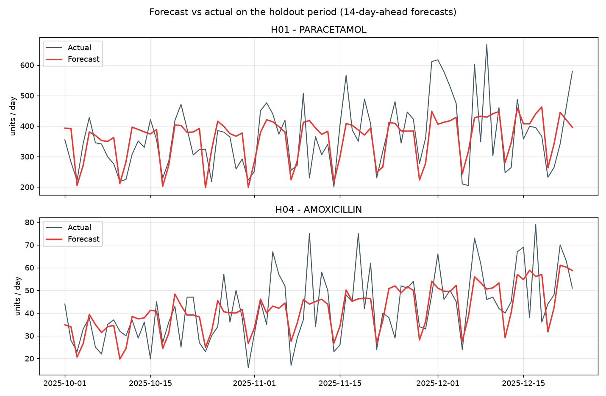
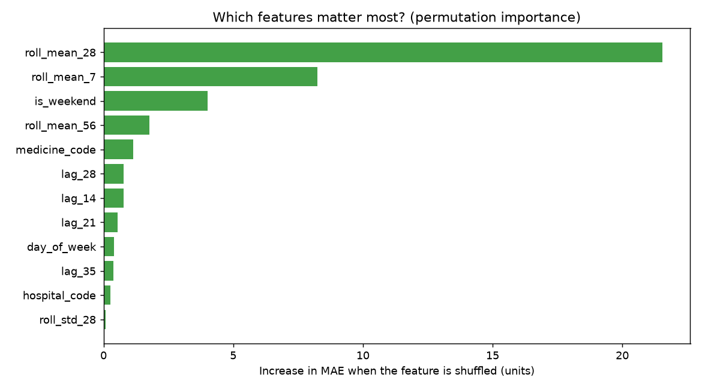

# Medicine Demand Forecasting 💊📈

[](https://github.com/Mohdsuhail06/medicine-demand-forecasting/actions/workflows/ci.yml)


Forecasts how many units of each medicine a hospital will dispense over the **next 14 days**,
and turns that forecast into a **reorder recommendation** (order now? how much?).
It is the machine-learning engine behind my
[MedPredict dashboard](https://github.com/Mohdsuhail06/medpredict) idea, built to reduce
both **shortages** and **expired stock** in hospital pharmacies.

> **Result:** the best model (Gradient Boosting with Poisson loss) cuts forecast error by
> **26%** compared with the naive baseline (WAPE **25.8% → 19.2%**) on a 3-month holdout
> it never saw during model selection. 👉 [Full results](reports/RESULTS.md)



## How it works



### 1. Data

Real hospital dispensing records are confidential, so the project uses a **documented
simulator** ([`data.py`](src/demand_forecast/data.py)) that produces 65,760 rows of daily
demand with realistic patterns:

| Pattern | Example |
|---|---|
| Hospital size | the large Amman hospital dispenses ~4× more than the small Karak one |
| Weekly cycle | Friday/Saturday (the Jordanian weekend) are 25–40% quieter |
| Seasonality | antibiotics and inhalers peak in winter, rehydration salts in summer, antihistamines in spring |
| Trend | diabetes and heart medicines grow 4–8% per year |
| Ramadan | fewer daytime visits; more antacid (omeprazole) use |
| Outbreaks | random winter flu waves push antibiotic demand up |
| Noise | negative-binomial counts, noisier than a simple Poisson process |

Because the true patterns are known, we can check that the model actually learns them.

### 2. Features without data leakage

To forecast day *t* we may only use what was known **14 days earlier**, so every lag is
≥ 14 days and every rolling window ends at *t − 14*
([`features.py`](src/demand_forecast/features.py)). A dedicated test proves it: changing the
last 14 days of history does not change a single feature.

### 3. Honest evaluation

A random train/test split would let the model see the future. Instead, **rolling-origin
backtesting** stands at a forecast date, trains only on the past, forecasts the next 14
days, then moves forward 14 days and repeats ([`evaluate.py`](src/demand_forecast/evaluate.py)).

| Period | Dates | Used for |
|---|---|---|
| Training | 2023-03 → each forecast origin | fitting |
| Validation | 13 × 14-day windows, 2025-04-01 → 2025-09-29 | **choosing** the model and measuring forecast uncertainty |
| Holdout | 6 × 14-day windows, 2025-10-01 → 2025-12-23 | **final check**, never used for any choice |

The deployed model is then retrained on all the data, as is standard; every score in this
README comes from the backtests above.

### 4. Models compared

| Model | Holdout WAPE | Holdout MAE | Bias |
|---|---|---|---|
| **Gradient boosting** (Poisson loss) | **19.2%** | **12.4** | −0.8% |
| Random forest | 19.4% | 12.6 | −1.1% |
| Ridge regression (log target) | 22.6% | 14.6 | −3.8% |
| Moving average, 28 days (baseline) | 25.1% | 16.3 | −4.4% |
| Seasonal naive (baseline) | 25.8% | 16.7 | −2.0% |

*WAPE = total absolute error ÷ total demand. Gradient boosting and random forest are
effectively tied (0.2 points apart on one simulated dataset); both clearly beat the
baselines. Performance is stable across two out-of-sample periods (19.3% on validation,
19.2% on holdout). Part of the remaining error is the random day-to-day noise built into
the data, which no model can predict.*



Permutation importance, measured out of sample (a model fit before the holdout, scored
on the holdout), shows that recent demand levels (28- and 7-day means) and the weekend
flag matter most, which matches how the data was generated:



### 5. From forecast to decision

[`inventory.py`](src/demand_forecast/inventory.py) applies the classic reorder-point method:

```
lead-time error = factor(L) × daily RMSE of the series × √L      (measured on validation)
safety stock    = z(service level) × lead-time error
reorder point   = forecast demand during lead time + safety stock
order now       = max(0, reorder point − current stock)
```

[`uncertainty.py`](src/demand_forecast/uncertainty.py) measures the daily error per hospital
and medicine, so less predictable medicines get a bigger buffer. The textbook √L rule
assumes daily errors are independent, but errors on neighbouring days move together, so
`factor(L)` is measured from the backtest (it grows from about 1.0 at L = 1 to 1.25 at L = 14).

**Does the buffer work?** On the holdout, demand stayed within forecast + safety stock in
**93.6%, 92.2% and 92.5%** of windows for lead times of 3, 7 and 14 days, against a 95%
target. The gap is honest: the uncertainty is measured on April–September, and the
holdout is winter, when flu outbreaks add errors the calmer months never show. A
season-aware error model is the next improvement. Each recommendation gets a
status: **Urgent order**, **Reorder**, **OK** or **Overstock** (more than 60 days of cover,
which risks expiry).

## Quick start

Requires Python 3.11+.

```bash
git clone https://github.com/Mohdsuhail06/medicine-demand-forecasting.git
cd medicine-demand-forecasting
python -m venv .venv
.venv\Scripts\activate          # Windows  (macOS/Linux: source .venv/bin/activate)
pip install -e ".[dev]"

demand-forecast generate        # 1. simulate 3 years of data  -> data/demand.csv
demand-forecast train           # 2. compare models (~1 min)   -> models/ + reports/
demand-forecast forecast --hospital H01 --medicine AMOXICILLIN --stock 300 --lead-time 7
```

### REST API

```bash
demand-forecast serve           # then open http://127.0.0.1:8000/docs
```

```bash
curl -X POST http://127.0.0.1:8000/forecast \
  -H "Content-Type: application/json" \
  -d '{"hospital_id": "H01", "medicine_id": "AMOXICILLIN", "current_stock": 300, "lead_time_days": 7}'
```

```json
{
  "hospital_id": "H01",
  "medicine_id": "AMOXICILLIN",
  "model": "Gradient boosting",
  "forecast": [{"date": "2026-01-01", "units": 191.9}, {"date": "2026-01-02", "units": 118.3}, "..."],
  "recommendation": {
    "expected_demand": 1188.2,
    "safety_stock": 102.1,
    "reorder_point": 1290.3,
    "order_quantity": 991,
    "days_of_cover": 1.8,
    "status": "Urgent order"
  }
}
```

Other endpoints: `GET /health`, `GET /hospitals`, `GET /medicines`. Inputs are validated
(for example `lead_time_days` must be 1–14), and unknown hospitals or medicines return `404`.

## Testing

80 tests (97% coverage): data patterns, leakage checks, train/serve consistency, model
selection on validation only, metrics, backtesting, safety-stock calibration, the reorder
logic, the API and the CLI. Warnings are treated as errors.

```bash
pytest --cov=demand_forecast
ruff check . && ruff format --check .
```

GitHub Actions runs everything on Python 3.11, 3.12 and 3.13 for every push.

## Project structure

```
medicine-demand-forecasting/
├── src/demand_forecast/
│   ├── data.py        # demand simulator (hospitals, medicines, patterns)
│   ├── features.py    # leakage-free features for 14-day-ahead forecasts
│   ├── models.py      # 2 baselines + Ridge, Random Forest, Gradient Boosting
│   ├── evaluate.py    # metrics and rolling-origin backtesting
│   ├── train.py       # model selection, final training, report
│   ├── forecast.py    # model bundle + inference
│   ├── uncertainty.py # forecast error over the lead time, coverage check
│   ├── inventory.py   # safety stock and reorder recommendation
│   ├── api.py         # FastAPI service
│   └── cli.py         # `demand-forecast` command
├── tests/             # pytest suite
└── reports/           # results and charts from the latest training run
```

## Limitations

- The data is **simulated**. On real hospital data the patterns would be less clean and
  extra signals (prices, stock-outs, public holidays, disease surveillance) would help.
- Every horizon day uses lags of at least 14 days, so the day-1 forecast ignores the most
  recent 13 days. This keeps one simple, leak-free model; separate models per horizon would
  be the usual upgrade for short lead times.
- The order quantity ignores stock already on order and review periods; a real system would
  subtract open orders before recommending a new one.
- The model is trained once and stored with `joblib`. Only load model files you created
  yourself, because `joblib` files can run code when loaded.
- The API has no authentication; it is meant to run locally or behind a gateway.

## License

[MIT](LICENSE) © 2026 Mohammed Suhail
