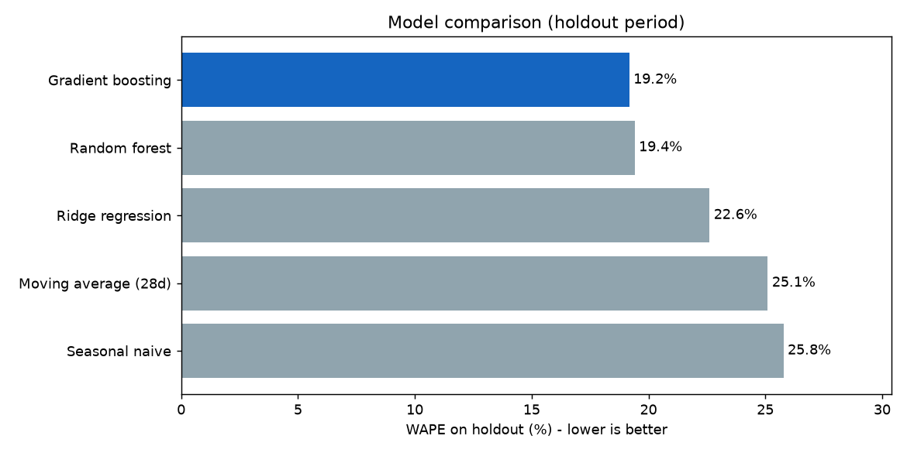
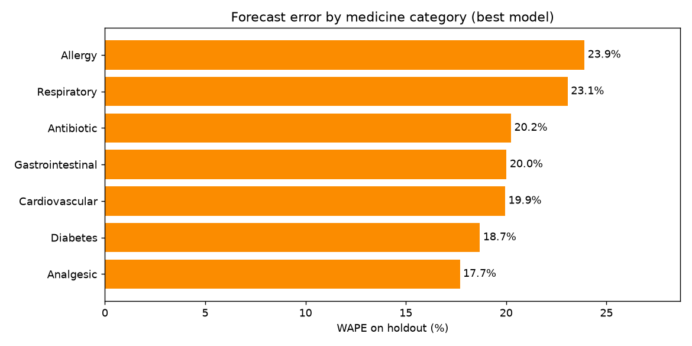
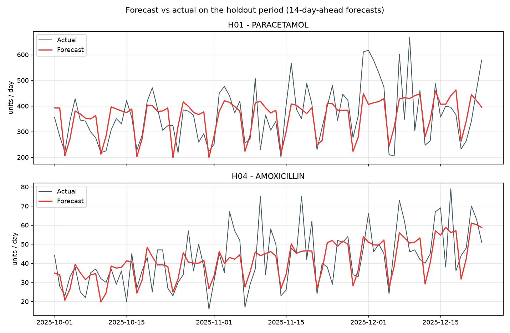
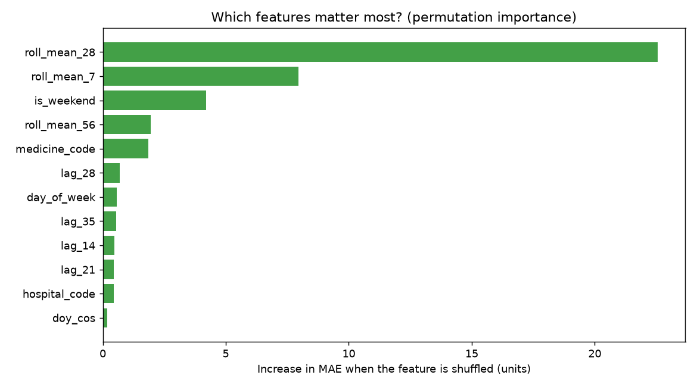

# Results

Data: 65,760 rows, 60 series (2023-01-01 to 2025-12-31).

Best model (chosen on validation): **Gradient boosting**. WAPE drops from **25.8%** (seasonal naive) to **19.2%** (26% fewer errors).

## Validation (2025-04-01 to 2025-09-30) - used to choose the model

| model | mae | rmse | wape | bias |
| --- | --- | --- | --- | --- |
| Gradient boosting | 11.44 | 18.69 | 19.28 | -0.19 |
| Random forest | 11.62 | 18.85 | 19.59 | -0.05 |
| Ridge regression | 13.09 | 21.83 | 22.06 | -5.52 |
| Moving average (28d) | 14.83 | 23.82 | 25.0 | 1.39 |
| Seasonal naive | 15.7 | 25.5 | 26.47 | 0.45 |

## Holdout (2025-10-01 to 2025-12-31) - final, untouched check

| model | mae | rmse | wape | bias |
| --- | --- | --- | --- | --- |
| Gradient boosting | 12.41 | 20.78 | 19.18 | -0.78 |
| Random forest | 12.56 | 21.07 | 19.41 | -1.14 |
| Ridge regression | 14.63 | 29.48 | 22.62 | -3.75 |
| Moving average (28d) | 16.25 | 27.21 | 25.11 | -4.41 |
| Seasonal naive | 16.68 | 28.18 | 25.78 | -1.97 |

## Error by category (best model, holdout)

| category | mae | rmse | wape | bias |
| --- | --- | --- | --- | --- |
| Allergy | 5.23 | 7.35 | 23.91 | -2.85 |
| Analgesic | 25.64 | 38.7 | 17.69 | -0.5 |
| Antibiotic | 11.08 | 16.66 | 20.24 | -2.92 |
| Cardiovascular | 11.33 | 15.33 | 19.95 | -0.25 |
| Diabetes | 11.44 | 17.34 | 18.69 | -0.73 |
| Gastrointestinal | 9.27 | 14.6 | 20.02 | 1.08 |
| Respiratory | 6.16 | 8.86 | 23.07 | -2.36 |

## Forecast examples

## Feature importance

